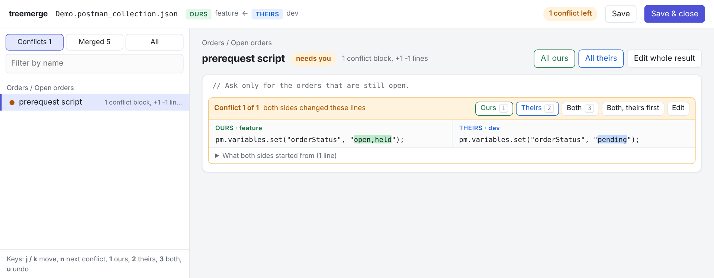
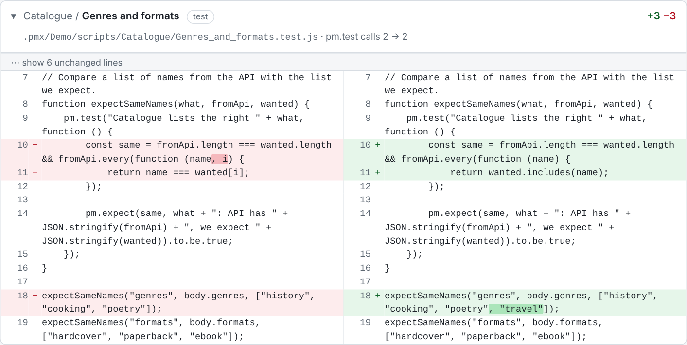
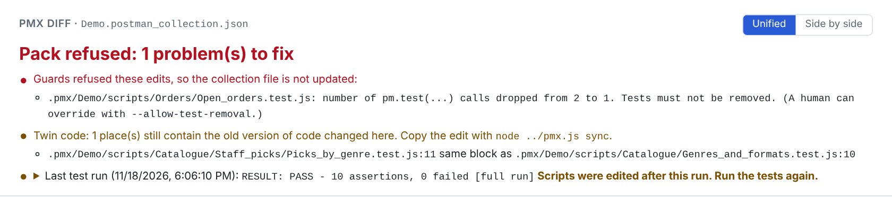

# pm-alt-editor

Two tools, no dependencies:

- **`treemerge`** — an interactive 3-way merge tool that understands structure. Any JSON file, with Postman collections as a built-in profile; any other text file line by line.
- **`pmx`** — fix failing Postman / newman tests without anyone editing the collection JSON.

---

# treemerge

git merges a file line by line. For a big JSON file that means conflicts that are not real ones (two branches each append an item to the same list; both edit different parts of one script) and real ones shown as escaped strings in a very large file.

`treemerge` merges by structure, then lets you settle what is left by clicking.



## Use it

```bash
git merge dev
```

If anything conflicts:

```bash
node tools/treemerge.js
```

It takes the three versions git already holds for every conflicted file, merges what can be merged, and, if decisions are left, opens a page in your browser (served from your own machine only):

- **Left:** every conflict, plus everything that merged automatically, grouped by where it lives (request, key path).
- **Right:** the conflict block with OURS and THEIRS side by side and the differing words highlighted. Click **Ours**, **Theirs**, **Both** or **Edit**. Keys: `1` `2` `3`, `n` next conflict, `j`/`k` move, `u` undo.
- Automatic changes can be reviewed and switched off one by one ("Do not apply").
- **Save & close** writes the file and runs `git add` when nothing is left open.

Decisions are stored as you go, so you can stop and come back.

The **Merged** tab lists what was merged without asking. Here the two branches edited different lines of the same script:


### What merges on its own

| Situation | Result |
|---|---|
| Both sides add different keys to one object, or items to one list | Both kept |
| Both edit the same script or multi-line string on different lines | Merged line by line |
| One side only re-indents a script | Not a change; the other side's edit wins |
| One side renames an item, the other edits it | Renamed and edited |
| Lists of objects with an `id` / `key` / `name` (inferred, must be unique) | Matched by that, not by position |
| Lists of the same length with no identity | Merged slot by slot |
| Postman ids and export timestamps regenerated on both sides | Ignored |
| One side deletes what the other never touched | Deleted |

### What you get asked about

- Both sides changed the same lines of a script or text.
- Both sides set one value differently.
- One side deleted what the other changed.
- Both sides extended a plain list (`["a","b"]`) at the same spot. "Both" usually settles it.
- A line-by-line merge that no longer parses as JavaScript (Postman scripts). The tool will not accept it until it does.

### Three ways to settle conflicts

| | Command | For |
|---|---|---|
| Browser | `node tools/treemerge.js` | You, at a desk. Default when run in a terminal |
| Terminal | `node tools/treemerge.js --tui` | SSH sessions. Answer `o` / `t` / `b` / `e` per block |
| Files and flags | `node tools/treemerge.js --no-ui` | Scripts and coding agents. Prints a numbered list; edit the small conflict files it names, or `--take-ours 1,3` / `--take-theirs 2` / `all` |

All three share the same stored decisions.

### Look before you merge

```bash
node tools/treemerge.js path/to/file.json --theirs origin/dev
```

Previews the merge and its conflicts. Your file is not changed; treemerge only keeps its notes in the hidden `.treemerge/` folder. Run in a terminal, it opens the browser view when there are conflicts. Add `--no-ui` for a text-only preview.

```bash
node tools/treemerge.js diff path/to/file.json HEAD origin/dev
```

What differs between two versions, by structure. `--only <text>` filters, `--full` prints changed script lines.

### Let git use it

```bash
node tools/treemerge.js install "*.postman_collection.json" "*.json"
```

- `git merge`, `rebase` and `cherry-pick` then merge those files by structure on their own, and only stop for real conflicts.
- `git mergetool -t treemerge` opens the interactive view for any conflicted file.
- Commit the `.gitattributes` it writes. Each teammate runs `install` once.

### How it knows what a file is

- **Postman collections and environments** (detected by name or content): folders and requests by name, events by `listen`, headers / variables / query params by `key`, scripts as code, `url` as one unit.
- **Any other JSON**: objects by key; for each list it looks for a field (`id`, `key`, `name`, ...) present on every element and unique in all three versions.
- **Anything that is not JSON**: line by line.

The file is written back in its own layout: untouched parts keep their exact bytes (indentation, inline lists, escapes, `1.0`), and only containers that changed are laid out again.

### Limits

- An item **moved to another list** on one side and edited on the other shows up as a delete-vs-change conflict, not a clean merge.
- Two items with the same name in one Postman folder are paired by position.
- A clean line-by-line merge can still be wrong in meaning (one side renames a variable, the other adds a use of the old name). Review the "Merged" tab and run your tests.
- JSON with comments is treated as plain text.
- During a rebase git swaps the roles: OURS is the branch you are rebasing onto.
- The browser UI was tested in Chromium.

---

# pmx

Fix failing Postman tests by editing small `.js` files instead of the collection.

Big collections store every script as a JSON array of escaped strings (`"    var x = \"a\";\r",`). Editing that by hand or with an LLM goes wrong in the same ways every time: escaping mistakes, a small fix that shows up as a huge diff because something got re-indented, and a fix applied to one copy of a helper but not the other requests it was pasted into.

`pmx` removes those failure modes with plain scripting:

| Problem | What pmx does |
|---|---|
| A huge JSON file full of escaped strings | `unpack` writes each script as a normal `.js` file. You edit that. |
| Noise diffs | `pack` splices only the lines you changed back into the **original bytes**. Whitespace-only edits are dropped. |
| Broken scripts, deleted tests | `pack` refuses syntax errors and any drop in the number of `pm.test(...)` calls. |
| A very long CI log | `digest` / `test` print a short list: request, test, `file:line`, the distinct error messages, and a list diff when two lists are compared. |
| Slow full runs | `test --failed` re-runs only the requests that failed. |
| Same helper pasted into several requests | `sync` finds identical copies of the block you changed and applies the same edit. |
| Tests that quietly stop running | The first run is the baseline; later runs flag any test that ran before and no longer does, and mark newly broken tests as `NEW`. |
| Reviewing a fix inside escaped JSON | `view` writes a read-only HTML page with the diff of every edited script, next to the guard results and the last test run. |

New here? Do the demo below first. It takes about five minutes and needs no real API.

## Try it: the demo

The repo ships a small sample collection with three failing requests, and a mock API for it to call. The API is a pretend bookshop; everything in it is made up. You need Node.js 18 or newer.

**1. Install, and create the sample collection**

```bash
npm install
```

```bash
node demo/make-demo.js
```

**2. Start the mock API.** Use a second terminal and leave it running.

```bash
node demo/mock-server.js
```

**3. Unpack the collection and run the tests.** Back in the first terminal:

```bash
cd demo
```

```bash
node ../pmx.js unpack Demo.postman_collection.json
```

```bash
node ../pmx.js test
```

The run fails, and instead of newman's full output you get this (one of the three failing requests shown):

```text
RESULT: FAIL - 5 of 10 assertions failed, in 3 request(s)   [full run]

X Catalogue / Genres and formats
  1x FAILED TEST: "Catalogue lists the right genres"
     edit -> .pmx/Demo/scripts/Catalogue/Genres_and_formats.test.js:9
     1x genres: API has ["cooking","history","poetry","travel"], we expect ["history","cooking","poetry"]: expected false to be true
        hint: only in 1st list: ["travel"]   only in 2nd list: []
  1x FAILED TEST: "Catalogue lists the right formats"
     edit -> .pmx/Demo/scripts/Catalogue/Genres_and_formats.test.js:9
     1x formats: API has ["ebook","hardcover","paperback"], we expect ["hardcover","paperback","ebook"]: expected false to be true
        hint: same members, different ORDER
  scripts for this request: .pmx/Demo/scripts/Catalogue/Genres_and_formats.test.js   (+1 inherited folder/collection script(s))
  failing calls: GET http://127.0.0.1:4010/catalogue -> 200

NEXT: edit the .js file(s) named above (smallest change), then run: node ../pmx.js test --failed
```

`edit ->` is the file and line of the failing test. The hints say what is wrong: the API has a `travel` genre that the test does not know about, and it returns the formats in a different order than the test lists them. For this demo the rule is that `travel` is a real genre and that the order does not matter, so the test is what needs to change.

**4. Fix the first script.** Open `demo/.pmx/Demo/scripts/Catalogue/Genres_and_formats.test.js` in your editor and make these two changes:

```diff
     pm.test("Catalogue lists the right " + what, function () {
-        const same = fromApi.length === wanted.length && fromApi.every(function (name, i) {
-            return name === wanted[i];
+        const same = fromApi.length === wanted.length && fromApi.every(function (name) {
+            return wanted.includes(name);
         });
```

```diff
-expectSameNames("genres", body.genres, ["history", "cooking", "poetry"]);
+expectSameNames("genres", body.genres, ["history", "cooking", "poetry", "travel"]);
```

**5. Re-run only the requests that failed.**

```bash
node ../pmx.js test --failed
```

`Catalogue / Genres and formats` is gone from the failure list. The output ends with a warning, because the same helper function is pasted into a second request:

```text
your edits so far (1 script(s)):
  M .pmx/Demo/scripts/Catalogue/Genres_and_formats.test.js   +3 -3
TWIN CODE: 1 place(s) still contain the old version of code you just changed:
  .pmx/Demo/scripts/Catalogue/Staff_picks/Picks_by_genre.test.js:11   (same block you edited at .pmx/Demo/scripts/Catalogue/Genres_and_formats.test.js:10)
  -> copy your edit there automatically with: node ../pmx.js sync
```

Let pmx copy the edit:

```bash
node ../pmx.js sync
```

**6. Fix the second script.** The remaining failure says that two open orders are waiting for the books `b-104` and `b-107`. Those two can only be pre-ordered so far, and the rule for this demo is that a pre-ordered book counts as available. Open `demo/.pmx/Demo/scripts/Orders/Open_orders.test.js` and allow it:

```diff
         const stuck = order.lines.filter(function (line) {
-            return line.status !== "in stock";
+            return line.status !== "in stock" && line.status !== "preorder";
         }).map(function (line) {
```

**7. Re-run the failed requests, then confirm with the full run.**

```bash
node ../pmx.js test --failed
```

```bash
node ../pmx.js test
```

```text
RESULT: PASS - 10 assertions, 0 failed   [full run]
```

**8. Look at what you changed.**

```bash
node ../pmx.js view --open
```


Six lines of the 239-line collection file changed (`git diff` shows each as one removed and one added line). Every other byte is the same as before. In a real repo this is where you commit it.

To start the demo over, run `node ../pmx.js restore --all` and then `node ../pmx.js pack`.

## Use it on your own collection

### Setup (once per repo)

1. Copy `pmx.js` into the repo (for example `tools/pmx.js`). It has no dependencies. For `merge`, `diff` and `merge-install`, put `treemerge.js` and `treemerge.ui.html` next to it.
2. Run `npm i -D newman`. It is only needed for `test` and `loop`.
3. Copy `pmx.config.example.json` to `pmx.config.json` in the repo root and fill it in:

   | Key | What to put there |
   |---|---|
   | `collection` | Path to your `*.postman_collection.json`. |
   | `newman` | The options you would pass to newman (environment file, timeouts, variables). Same names as the [newman library](https://github.com/postmanlabs/newman#api-reference). `${NAME}` is replaced from environment variables, so tokens stay out of the file. |
   | `alwaysRun` | Names of requests that must run before anything else, such as a login. `test --failed` runs these plus the failed requests. |

4. Add `.pmx/` to `.gitignore`.
5. Unpack the collection:

   ```bash
   node tools/pmx.js unpack path/to/Your.postman_collection.json
   ```

Run every command from the repo root.

### Fix a failing run

**If you can run newman from your machine**

1. Get the failure list:

   ```bash
   node tools/pmx.js test
   ```

2. Open the file named after `edit ->` and make the smallest change that fixes it.
3. Re-run only what failed. Repeat steps 2 and 3 until it passes.

   ```bash
   node tools/pmx.js test --failed
   ```

4. If the output says `TWIN CODE`, run `node tools/pmx.js sync`, then `test --failed` again.
5. Confirm with the full run:

   ```bash
   node tools/pmx.js test
   ```

6. Review the change:

   ```bash
   node tools/pmx.js view --open
   ```

7. Commit the collection file. Nothing under `.pmx/` is committed.

**If you only have a CI log**

1. Save the newman or Jenkins console output to a file and get the failure list from it:

   ```bash
   node tools/pmx.js digest console.txt
   ```

2. Edit the file named after `edit ->`.
3. Write your edits into the collection. `digest` does not do this for you; `test` does.

   ```bash
   node tools/pmx.js pack
   ```

4. Review with `node tools/pmx.js view --open`, commit, push, and run `digest` on the next log.

### What the messages mean

| Message | Meaning | What to do |
|---|---|---|
| `edit -> file:line` | Where the failing `pm.test` lives. | Open that file at that line. |
| `PACK REFUSED` | An edit has a syntax error or removed a `pm.test`. The collection file was not changed. | Fix exactly what it lists. |
| `TWIN CODE` | Other requests contain the old version of the code you changed. | Run `sync`. |
| `NEW: this passed before your edits` | Your edit broke a test that was passing. | Undo that part of the edit. |
| `TESTS THAT STOPPED RUNNING` | A test that ran in the first run no longer runs at all. | Bring it back. If the removal is intended, a human re-runs with `--rebaseline`. |
| `whitespace-only line edit(s) ignored` | Re-indenting and similar edits were dropped so the diff stays small. | Nothing. Use `--keep-whitespace` if the whitespace change was the point. |
| `was changed by something other than pmx` | The collection file changed since `unpack` (a pull, a Postman export). | Run `unpack` again. If you still have edits that are not in the collection, it stops and asks for `--force`, which discards them. Copy those `.js` files somewhere first and re-apply the edits afterwards. |

### Let an AI assistant make the edit

With the `claude` CLI installed, the script can run the whole loop:

```bash
node tools/pmx.js loop --why "One or two sentences: what changed and what is now correct."
```

`loop` runs newman, hands the failure list and your sentence to `claude -p --model haiku` (edit tools only, no shell), syncs twin code, re-checks the guards, re-runs the failed requests, then the full suite. It stops when green, after `--max` attempts (default 4), or when the model answers `NEEDS-HUMAN`.

Inside Claude Code you can use the agent instead: copy `claude/postman-fixer.md` to `.claude/agents/`.

With any other assistant, give it the rules and procedure from `claude/postman-fixer.md` and let it edit the `.js` files. The guards in `pack` apply no matter who made the edit.

## Commands

| Command | Does |
|---|---|
| `unpack <collection.json>` | Write scripts to `.pmx/<name>/scripts/**.js` |
| `ls [text]` | List script files, filtered by request name |
| `digest <log\|->` | Failure list from a newman or Jenkins console log |
| `test [--failed] [--folder <name>]` | Pack, run newman, print the failure list. Exit 0 = green |
| `sync` | Copy your edit to identical copies in other scripts |
| `status` | Show pending edits. Writes nothing |
| `view [--open]` | Write the edits as a read-only HTML diff page (`.pmx/<name>/diff.html`) |
| `pack` | Write edits into the collection (`test` does this for you) |
| `restore <file>` / `restore --all` | Throw away edits |
| `loop --why "..." [--model haiku] [--max 4]` | The automated fix loop |
| `merge` / `diff` / `merge-install` | Shortcuts to treemerge for the configured collection. treemerge's own mode flags (`--ui`, `--tui`, `--no-ui`) are not passed through yet; run `treemerge.js` directly to use them |

Human-only overrides: `--keep-whitespace`, `--allow-test-removal`, `--rebaseline`, `--force`.

The `view` page shows each changed script as a unified or side-by-side diff with the changed words marked, whether the guards passed, whether the collection file already contains the edits, twin code that `sync` has not updated yet, and the last test result. It is a snapshot: run `view` again after more edits. Without `--open` it only writes the file and prints its address.

One script in the side-by-side layout:



When something needs attention, the top of the page says so. Here a guard refused an edit that removed a test, a pasted copy of the changed code is still out of date, and the scripts were edited after the last test run:



## Experimental: the whole collection as files

`pmx unpack` turns only the scripts into files. `pmx tree` is a separate, experimental mode that does it for everything: each request, each folder and the collection itself get a small definition file, next to the same plain `.js` script files. It is a trial of the collection-as-code idea. Every other command works as before.

```bash
node tools/pmx.js tree unpack path/to/Your.postman_collection.json
```

Edit the files under `.pmx/<name>/tree/`, then build the collection from them and let newman check it:

```bash
node tools/pmx.js tree test
```

| Command | Does |
|---|---|
| `tree unpack <collection.json>` | Write every request, folder and script as its own file under `.pmx/<name>/tree/` |
| `tree pack` | Build the collection from the files. Only what changed moves in the JSON |
| `tree test [--environment <file>]` | Pack, then run newman on the result, optionally with a Postman environment file |
| `tree check <collection.json> [--run]` | Measure the round trip: unpack, build, compare with the original. `--run` also compares newman results |

The files for the demo collection:

```text
collection.js                      variables, auth and the other fields of the collection itself
collection.prerequest.js           the script that runs before every request
Catalogue/folder.js                a folder's own fields, and the order of what is in it
Catalogue/Genres_and_formats.request.js    one request: name, method, URL, headers, body
Catalogue/Genres_and_formats.test.js       that request's test script, as plain JavaScript
Catalogue/Staff_picks/folder.js
...
```

A definition file is `module.exports = ` followed by JSON. Two markers stand in for what lives in other files: `{"$script": "Ping.test.js"}` where a script's lines go, and `{"$children": ["Ping.request.js", "Staff_picks/"]}` where a folder's content goes, in order.

Through these files you can:

- change a URL, a header, a body, auth or a variable;
- edit the collection-level and folder-level scripts that many requests share;
- add a request (write its file and list it in `$children`), remove one, reorder or rename requests and folders.

`tree pack` applies the same guards as `pack` (syntax errors and removed `pm.test` calls are refused) and writes the collection in its own layout, so the diff holds only what you changed.

What this trial does not do yet:

- Definition files are read as data and never run, so the part after `module.exports = ` must be strict JSON: no comments, no trailing commas.
- `tree test` lists failing tests by request. It does not point to a file and line the way `pmx test` does.
- The two modes keep separate working copies. Use one at a time on a collection; each refuses to pack over a file the other has changed.
- It needs `pmx-tree.js` next to `pmx.js`. With `treemerge.js` there too, the collection keeps its layout; without it, the file is written in plain JSON layout.

## Limits

- pmx only edits **scripts** (`event[].script.exec`). Request URLs, bodies, headers and collection variables are never touched, so a fix that needs those is still a manual edit.
- `--failed` runs the failing requests on their own. If they need a login or setup request first, list those names under `alwaysRun` in the config.
- `digest` reads newman's `#  failure  detail` table. Logs with a timestamp prefix on every line are not parsed.
- The guards catch removed tests and syntax errors. They cannot tell whether an expected value is *right*. That is what the `--why` sentence and the final diff review are for.
- If the collection file changes underneath pmx (a merge, a pull, a Postman export), `pack` stops and asks you to `unpack` again.

---

# Setup

Copy the files you want into your repo, side by side (for example `tools/`). Run every command from the repo root.

| Tool | Files to copy | Also needed |
|---|---|---|
| treemerge | `treemerge.js`, `treemerge.ui.html` | Nothing. Its scratch folder `.treemerge/` is hidden from git automatically. |
| pmx | `pmx.js` | newman, a `pmx.config.json`, and `.pmx/` in `.gitignore`. The steps are under [Setup (once per repo)](#setup-once-per-repo). |
| pmx `merge` / `diff` / `merge-install` | `pmx.js` next to the two treemerge files | For `diff` and `merge --theirs`: a `collection` in `pmx.config.json`, or `--collection <file>`. |

In Claude Code, copy `claude/*.md` to `.claude/agents/`: `merge-resolver` settles merge conflicts, `postman-fixer` fixes failing assertions. Both are written for a small model.

# What leaves your machine

| Command | Network use |
|---|---|
| pmx `unpack`, `ls`, `status`, `pack`, `sync`, `restore`, `digest`, `view` | None. They read and write local files only. |
| pmx `test` | Runs newman, which calls the hosts your collection and environment name. pmx adds no calls of its own. |
| pmx `loop`, the `postman-fixer` agent | Send script source and failure lists (these can include response data that your tests log) to the Claude model you run them with. Use them only where your employer allows that. Everything else works without them. |
| `treemerge`, and pmx `merge` / `diff` / `merge-install` | No outside calls. They read the versions git already holds and write the merged file. |
| The `merge-resolver` agent | Sends the conflict blocks it resolves to the Claude model you run it with. Same rule as above. |

The pmx `view` page is one static file. It contains no JavaScript, loads no fonts, images or other files, and carries a Content-Security-Policy that blocks scripts and every network request. Text from your scripts is escaped. In script lines, the common invisible and text-direction characters (control characters, zero-width spaces and joiners, direction marks, overrides and isolates) are shown as `U+XXXX`. Rarer blank characters, such as Hangul fillers and variation selectors, are not marked yet. Nothing listens on a port.

The treemerge browser view is the one thing that does listen on a port. It is served by a small server inside treemerge that accepts connections from your own machine only (`127.0.0.1`), on a random free port, and answers only requests that carry the secret key in the link it prints. It rejects requests addressed to any other host name, and it stops when you choose **Save & close** or press Ctrl+C. `--tui` and `--no-ui` start no server.

`treemerge install` changes this clone only: it adds a merge driver and a mergetool to the clone's git config and writes the file patterns to `.gitattributes`.

`.pmx/` holds a full copy of the collection, the last run's output and the diff page. Keep it out of git (step 4 of the pmx setup) and treat `diff.html` like source code if you send it to someone.

The example config sets `"insecure": true`, which turns off TLS certificate checks in newman. Remove that line unless your test environment needs it.

# Self-test

```bash
npm install
```

```bash
npm test
```

34 end-to-end checks: pmx against a demo collection and a mock API (18, including byte-identical round trips for 8 export shapes), and treemerge on its own, through real `git merge` runs, in the terminal, and over the browser UI's API (16, including 1,500 random documents).

The experimental tree mode has 8 checks of its own (`node test/tree.test.js`), which `npm test` runs as well: round trips of nine file layouts, a collection of about 1,700 requests, 250 random collections, edits through the files, and what `tree pack` refuses.
